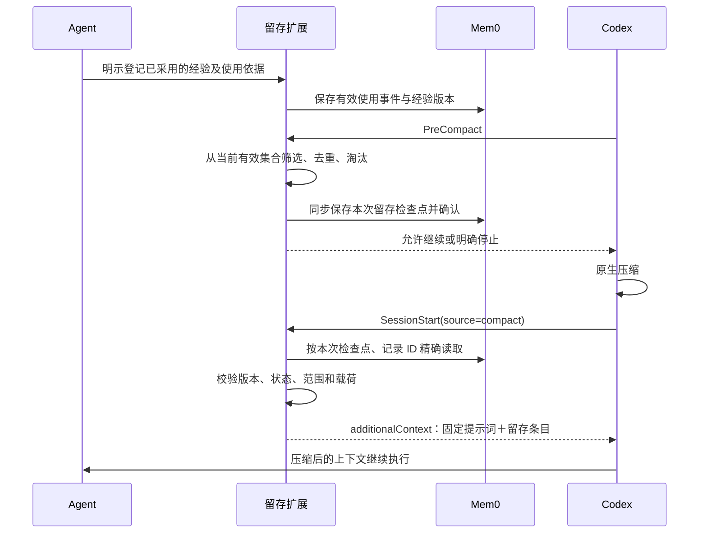

# Mem0 压缩留存 Hook 与提示词设计

日期：2026-10-12。状态：协议 v1、正式留存区的保证范围及跨项目插件方向已获用户确认；具体能力、配置和实施计划为本轮设计，尚未实施。

## 1. 结论与范围

采用“显式使用登记 → 压缩前确定性筛选 → Mem0 检查点 → 压缩后精确恢复”。提示词说明规则的使用与留存含义，代码负责排序、去重、预算和版本检查。

- 核心规则保持固定遍历集合，走可信核心入口恢复；不纳入非核心淘汰预算。首期扩展恢复的固定核心为：只遍历核心、非核心按任务查询、Mem0 唯一经验库、只接纳有效读取与使用回执、留存区和指令层级分离、失效/读取失败不冒充无经验。入口是受审阅的扩展固定提示词。现有 SLS 业务约束仍由宿主及项目可信入口提供，本扩展不重新定义业务核心成员。
- 非核心经验正文及留存摘要只在 Mem0 作为持久经验数据保存；不新增本地经验库或规则缓存。
- 用户已明确要求该功能可在多个项目通用。建议以独立通用插件交付，首期验证 Codex 的项目根会话；多个项目共用机制，项目经验及会话控制状态默认隔离。跨项目经验共享、子 Agent 的独立压缩及云端执行不在首期支持声明内。
- 本轮仅设计，不注册 Hook、不改插件缓存、不改 Codex 配置、不触发真实压缩、不提交或推送。

**已确认的能力边界**：用户选择以正式留存区为准，旧摘要不再作为有效规则依据。本方案控制正式留存区、登记有效集合及后续规则采用；不要求清除原生压缩摘要或不透明压缩状态中的全部旧经验。需要采用留存区外的经验时，必须重新从 Mem0 精确读取、核验并登记，不能由旧摘要重新激活已淘汰或失效记录。该选择确认保证范围，不代表用户已要求实施 Hook。

## 2. 已确认协议

标记形式：`【留存:P1|EXP-EXAMPLE-001|U42】一行规则摘要`。该行是格式示例，不是有效经验。

| 字段 | 语义 |
| --- | --- |
| P1 / P2 / P3 | 当前任务关键约束 / 一般适用经验 / 参考信息；P1 > P2 > P3 |
| 经验 ID | 稳定标识；内部同时关联真实 Mem0 记录 ID |
| U | 本会话最近有效使用的单调序号；不是 Mem0 创建日期或全局热度 |

同 ID 保留最新有效版本。预算不足时先淘汰最低优先级，再淘汰同级 U 最小者，同级同 U 按 ID 的 ASCII 字典序决定。每条标记与摘要整条保留或移除；移除不删除 Mem0 记录。压缩、恢复或纯重复召回不刷新 U。

## 3. 当前接口证据

| 接口 | 证据与设计影响 |
| --- | --- |
| PreCompact | 官方契约只提供公共控制输出；没有追加压缩模型指令的输出字段。用于同步检查点准备，不输出模型提示词 |
| PostCompact | 官方契约提供完成后的控制输出；用于记录压缩边界，不作为上下文注入入口 |
| SessionStart，source=compact | 官方文档规定其 additionalContext 在根会话压缩后的下一次模型请求前进入上下文；作为恢复入口 |
| compact_prompt / experimental_compact_prompt_file | 配置是压缩提示词覆盖入口，不是 Hook 动态追加入口；首期不依赖，不修改 |
| transcript_path | 官方声明格式不是稳定接口；需要版本适配，不对整份历史任意搜索标记 |

本机主 CLI 为 0.160.1。其二进制内嵌 Schema 静态核验：PreCompact/PostCompact 只允许公共输出字段；SessionStart 支持 compact 和 additionalContext。此证据不证明实际触发顺序、续跑注入或配置覆盖生效。

Mem0 0.3.3 当前 PreCompact 只触发后台归纳，SessionStart 只记录会话；缺少本设计的筛选、检查点和恢复机制。现有原生 search_memories 不展示记录 ID、metadata，不适合作为精确恢复接口。

来源：[Hooks](https://learn.chatgpt.com/docs/hooks)、[配置参考](https://learn.chatgpt.com/docs/config-file/config-reference)。本机插件证据：`hooks/hooks.json`、`hooks/adapter.py`、`core/hook_runner.py`、`core/mcp_server.py`、`core/memory_core.py`。

## 4. 职责与流程



| 部件 | 负责 | 不负责 |
| --- | --- | --- |
| 核心规则提供方 | 固定可信入口及核心规则恢复 | 语义排名和非核心淘汰 |
| 使用登记入口 | 接受经验 ID、等级和实际用途，校验已读取记录、来源与版本，分配 U | 自动猜测 Agent 是否理解或遵守 |
| 会话适配器 | 提取有明确来源的登记回执、会话及压缩边界 | 把示例、引用、源代码或任意工具原文当经验 |
| 留存选择器 | 确定性去重、排序、预算与整条淘汰 | 调用模型重新概括或改写规则 |
| Mem0 Adapter | 同一仓库范围内精确读写、保存确认、版本及状态检查 | 用语义搜索代替检查点定位 |
| 恢复器 | 读取本次检查点，注入完整载荷及简短说明 | 遍历全部非核心经验 |

使用登记入口是待实现能力，不是当前已有的 MCP 工具。首期同步提供精确读取入口：调用同仓库 Mem0 精确读取接口，返回真实 Mem0 ID、稳定经验 ID、状态、版本/摘要指纹和读取回执 ID。只有这类回执能登记留存；现有原生语义结果可以提供线索，但必须经过精确读取确认身份。

Agent 在经验实际支撑当前结论、行动或核验时，提交读取回执 ID、等级和使用依据。登记入口核对回执范围、版本和记录有效状态，再产生有效使用回执；不能仅凭 Agent 自报 ID 或出现标记认定有效使用。回执包含真实 Mem0 ID、稳定经验 ID、等级、版本/摘要指纹、U 和使用依据。

运行时按本根会话已提交的有效使用事件顺序分配 U，Agent 不自行编造序号。首次接纳创建当前 U；真实使用更新 U；压缩后的注入沿用旧 U。读取回执、有效使用事件、U 游标和当前有效集合均以 Mem0 中的会话控制记录为权威；本地仅持有控制指针和用于同会话串行化的锁，不保存规则列表。同一个使用事件的重试复用原 U，不再次更新。同会话多次使用只保留当前有效登记。

## 5. Hook 分工

| Hook | 设计行为 |
| --- | --- |
| UserPromptSubmit | 在新窗口首次需要时补充简短登记约定；已有经验查询规则仍负责独立任务和范围变化时检索 |
| PostToolUse | 只接收已核验的登记入口回执，维护当前有效集合；不扫描所有工具正文 |
| PreCompact | 同步筛选并写入本次 Mem0 检查点，确认后才发布就绪指针；不等待原生后台归纳替代确定性保存 |
| PostCompact | 记录压缩完成边界，用于关联本次检查点；不读取密文以猜测规则是否保留 |
| SessionStart，matcher=^compact$ | 同步恢复本次检查点，通过 additionalContext 注入固定提示词与选中条目 |

扩展应独立于原厂 Mem0 插件缓存维护，复用已验证的凭据与仓库范围解析。采用 command Hook；不依赖尚未执行的 prompt/agent Hook 类型，也不要求 SessionStart 时 MCP 已连接。

## 6. 状态、存储和防止旧内容复活

- Mem0 检查点保存：仓库范围、session_id、压缩代次、协议版本、会话游标、选中记录 ID/稳定 ID/等级/U/版本指纹、预算及状态。
- 读取回执、使用事件、活动窗口和检查点使用不同控制记录类型，由精确过滤查询定位，排除于普通经验召回；写入跳过事实推断。实施前验证控制记录不会被自动归纳改写，不能满足时不得宣称控制状态可靠。
- 摘要优先使用 Mem0 中已核验的留存摘要；缺少摘要时使用完整经验的一行表示，不在压缩临界阶段调用模型裁剪条件或例外。检查点无需复制经验正文。
- 检查点使用独立 record_kind；正常经验查询在服务端排除会话检查点，不能让其占用语义召回名额。
- 本地只允许保存会话到检查点的代次、状态及 ID 指针，不保存规则正文、摘要或规则列表；这是控制元数据，不是第二份经验库。发布指针采用原子替换。
- 检查点键绑定仓库、会话和压缩边界；同一边界重试复用键。开始准备即标记 pending，只有服务端确认和回读完成才标记 ready。恢复不能拿上一次 ready 冒充本次。
- 压缩后当前有效集合以本次选中集合为基线，之后只接纳新的有效使用回执。禁止扫描所有历史重新纳入已淘汰条目；被淘汰经验只有后续明确重新读取并采用时才重新进入集合。
- 恢复器剔除失效/改版记录、按当前预算再次淘汰后，先将实际恢复 ID/版本/等级/U 集合提交为新活动窗口并回读，再发布 additionalContext。活动窗口提交失败则不发布恢复正文、请求停止续跑。下一次 PreCompact 读取这个实际活动窗口及之后的新使用事件，不重新使用原检查点的较大集合。
- Mem0 中经验已废止、删除、待核实或版本指纹改变时，不恢复旧摘要。记录未恢复项，要求按当前材料重新读取/核验；不得静默使用旧副本。
- 现有插件的 EvidenceStore 会保存 retrievals.memory_text；新 Hook 无缓存不代表现有链路已满足“不存本地”。实施前需明确禁用这份经验缓存或调整现有注入链路；本方案不把宿主原生会话记录包装成经验库。

## 7. 预算与失败行为

首期建议本扩展总注入载荷上限为 **8 KiB UTF-8**，先扣除固定提示词、包装和本扩展固定核心内容，剩余才分配给非核心。宿主原生指令及项目指令不计入这份扩展预算，仍占用整个模型上下文；不得因此声称它们不计上下文成本。这是可确定计算的字节预算，不冒充模型 token 数；默认值由助手建议，尚未实测。

恢复时重新计算整份载荷。优先级和 U 沿用检查点；体积变化或配置预算变小，继续按协议淘汰，淘汰结果成为当前有效集合。单条超过可用预算则整条移除，不输出残缺规则。核心载荷自身超限不能通过淘汰核心解决，应报告无法建立窗口。

官方 Hook 会对超限 additionalContext 落盘并输出预览。首期拟仅在扩展已具备严格字节上限、且本机验证配置生效后使用 additionalContextLimit=0，避免规则落盘和摘要被宿主截断；不是无限输出许可。尚未核验的本机配置不能视为已生效。

网络请求、精确读取及检查点提交均采用有界超时。无可信本次检查点、核心固定提示词无法建立或新活动窗口提交失败时，恢复器请求 continue=false。单条恢复按以下条件处理：

| 原因 | 处理 |
| --- | --- |
| 按既定预算淘汰，包括旧 P1 | 允许继续，这是协议明确的整条淘汰，不升级为核心保护 |
| 服务端明确删除/废止 | 从集合移除并标记已失效，不沿用旧规则；允许继续 |
| P1 精确读取失败、状态不明或版本改变 | 不发布本次恢复正文，请求停止本次续跑；通过重新读取与核验建立有效状态后重试 |
| P2/P3 精确读取失败、状态不明或版本改变 | 留下未恢复 ID 及原因，提交其余实际集合后允许继续；需要该经验时重新读取与核验 |

这些是助手提出的失败策略。Hook 崩溃、超时或宿主未执行 Hook 时可能仍继续；端到端保证须在原生场景核验，不能仅靠提示词或一个返回值承诺。

## 8. 提示词设计

### 8.1 运行期登记提示词：由可注入上下文的 Hook 提供

> 只遍历核心规则。非核心经验按当前任务从 Mem0 读取；只有已经核验且实际支撑当前判断、行动或核验的经验，才通过登记入口提交经验 ID、P1/P2/P3 和使用依据。等级仅表示留存顺序。U 由运行时分配；重复召回、压缩和恢复不更新 U。不得登记格式示例、引用、源代码或未经核验的工具原文。规则正文和摘要不写入本地经验库。

### 8.2 压缩提示词补充段：可选配置覆盖路径，首期不启用

下面是对原压缩任务的补充段，不是独立完整压缩提示词，也不是 PreCompact 返回内容。只有确认当前压缩路径实际使用配置时，才能将“原默认压缩指令＋此补充段”整体配置；不在 Hook 中临时改配置或重写压缩文件。

> 保留当前目标、用户约束、已确认决策、未完成工作和验证边界。正式经验留存区内条目的标记、ID、等级、U 与摘要应完整保留，不刷新 U；代码示例和引用中的同形标记不是经验。留存选择与预算淘汰由 Hook 确定，不凭普通历史叙述猜测当前有效集合，也不将条目合并成失去标识的叙述。如果可见输入包含本次已确认的选中清单，只保留清单内条目；如果没有这份清单，不宣称已经完成筛选，注明压缩后需要恢复。核心规则不得进入非核心淘汰集合。不把保存或 Hook 执行成功写成规则已遵守。压缩后正式留存区为有效集合依据，旧摘要中的经验描述不能重新激活已淘汰或失效记录。

压缩模型是否逐字保留不能由提示词保证；保证目标由检查点和压缩后恢复承担。若压缩产物为不透明状态，不能宣称已通过读取摘要验证。

### 8.3 压缩后恢复提示词：SessionStart(compact) 的正式注入内容

> 以下经验留存区由本次压缩检查点恢复，并已提交为当前活动窗口，只包含本次选中的有效非核心条目。继续执行原任务，并先按固定入口检查核心规则；无需遍历 Mem0 全部经验。旧摘要中的经验叙述不自动成为当前有效规则；需要采用留存区外的经验时，重新从 Mem0 精确读取、核验并登记。条目的 ID、等级与 U 沿用原值，恢复不算新的有效使用。P1/P2/P3 只表示留存优先级，不改变指令层级、适用范围或操作授权。只有规则实际再次支撑判断、行动或核验时才更新登记。未恢复项不是“无经验”；明确失效项不得继续沿用。经验资料仍须结合当前任务、状态和来源判断适用性。不要把示例标记登记为经验，不将正文写入本地经验库。

运行时包装携带协议版本、检查点 ID、窗口游标和未恢复 ID，正文仅放在明确的经验留存区。包装由扩展生成，不允许原始经验文本提前关闭区块或伪造控制字段。

## 9. 实施前验证与验收

| 检查 | 必须证明的行为 |
| --- | --- |
| 原生手动及自动压缩 | 本次 PreCompact → SessionStart(compact) 关联正确，自动压缩续跑前实际可见 |
| 连续多次压缩 | ID、等级与 U 不刷新；已淘汰旧条目不会从历史重新进入 |
| 超预算、同级同 U | 淘汰顺序确定；标记及摘要完整，核心不参与淘汰 |
| 真实有效使用 | 登记回执可定位到读取记录和用途；纯召回及格式示例不刷新 U |
| Mem0 删除、更新、失效 | 旧版本不恢复；不把读取失败当无命中 |
| 保存中断与重复事件 | 未确认检查点不发布 ready；不复用旧代次，不创建同键副本 |
| 输出上限及配置 | 无宿主落盘/截断；覆盖配置实际生效与否分开记录 |
| 本地文件与日志 | 扩展无规则正文缓存，现有插件缓存处理已明确 |

下一阶段先做接口验证，随后实现最小根会话链路。只有原生证据通过后，才能声明 Hook 在已验证范围内提供压缩后留存；本文件不证明该能力已实现。

## 10. 跨项目封装方向（已确认采用插件，尚未实施）

**采用插件为交付载体，内置少量 Skill、Hook、精确读写/使用登记工具及 Mem0 Adapter。** 用户随后确认并要求设计插件实现步骤。Skill 负责经验使用和维护方法，运行时负责确定性状态与生命周期处理；两者是组成关系，不是互斥选项。

| 维度 | 独立 Skill | 插件包 |
| --- | --- | --- |
| 跨项目复用 | 用户级 Skill 可复用 | 用户级安装，项目级可启停及覆盖策略 |
| 压缩自动处理 | 需要另行配置 Hook；Skill 指令不能替代生命周期事件 | 可打包 Hook 及运行时脚本，统一安装与审阅 |
| 精确读取与 U/检查点 | 可以指引 Agent 调用脚本，但仍需稳定的工具和状态实现 | 工具、状态逻辑、提示词与协议作为同一版本发布 |
| 维护成本 | 单纯方法指导较低；外挂 Hook 后需协调多份配置 | 首期开发成本较高，后续集中升级与验证 |

### 通用性边界

- **机制通用**：协议、优先级、淘汰、U、版本校验及恢复流程不包含 SLS、C#、DDD 或特定业务假设。
- **策略按项目提供**：项目核心入口、启停、预算及适用主题由项目设置提供；已有 AGENTS/项目约定继续作为可信入口，不复制进通用包。
- **数据默认隔离**：按稳定仓库身份、会话和压缩代次精确定位，EXP-ID 只在其项目范围内使用；不同项目不能因同名 ID、相同本机目录名或同一用户而串读。相同仓库的 worktree 可以共享项目经验，但会话登记、U 和检查点分开。
- **共享须显式选择**：跨项目通用经验另设明确共享范围；在用户授权共享前，不自动扩大查询范围或迁移现有经验。
- **环境分别适配**：先针对当前 Codex 环境，其他 Agent 客户端及云端需要各自的生命周期适配与验证；不能把多项目通用写成所有客户端可用。

### 分发与现有 Mem0 插件的关系

首期建议独立维护插件源目录/仓库，通过个人或团队的本地/Git marketplace 分发，避免每个业务仓库复制一份 Hook。只在项目需要差异时提供轻量配置。当前带 lifecycle hooks 的插件不能按无 Hook 的插件路径直接进入官方公共插件目录，且 Hook 定义需要宿主信任审阅。

运行时通过 Mem0 Adapter 使用已确认的仓库命名空间、API 和凭据读取策略；不把现有 0.3.3 的缓存绝对路径或私有函数导入作为通用包的长期依赖。现有 Mem0 插件的自动召回、后台捕获和本地正文缓存需要兼容方案，登记与压缩恢复只保留一个责任方，避免重复注入、重复保存及恢复不一致。本轮不卸载、禁用或修改已有插件。

建议下一阶段补充独立插件的最小职责及配置契约，再以两个不同项目验证机制复用、数据隔离和项目启停；不是要求目前运行其他项目的业务测试。

官方依据：[插件架构](https://developers.openai.com/plugins/concepts/plugins)、[插件打包与分发](https://developers.openai.com/plugins/build/plugins)、[Skill 的使用与分发](https://learn.chatgpt.com/docs/build-skills)。用户确认多项目通用及插件方向；具体能力、配置和分发细节为设计决策，尚未安装或实现。

## 11. 插件记忆核心能力与实现决策

本节将“核心能力”定义为插件必需的功能，不与“必须逐项校验的核心规则”混用。用户本轮要求设计插件实现步骤与记忆核心能力，不构成写代码、安装或停用现有插件的指令。

### 11.1 最小功能集合

| 能力 | 输入与结果 | 必须守住的边界 |
| --- | --- | --- |
| 核心规则入口 | 扩展固定核心＋项目明确声明的核心入口，输出带来源的固定清单 | 不自动从 Mem0 提升核心，不遍历全部非核心；读取失败不声称校验通过 |
| 任务检索 | 当前问题＋可选主题/标签，返回相关经验及来源、状态、指纹 | 仅在当前项目授权范围；控制记录不参与经验搜索；未命中不证明没有经验 |
| 精确读取 | 真实记录 ID，返回核验后的正文/摘要与读取回执 | 项目/会话绑定、稳定 ID、状态和版本可检查；无法确认时不登记 |
| 显式录入与维护 | 已通过 Skill 判定的候选，执行新增、同 ID 更新或失效标记 | 语义验重＋稳定 ID 核对；保留来源，写入回读；首期不做全库清理或自动硬删除 |
| 有效使用登记 | 读取回执＋等级＋用途，返回实际 U 与活动窗口版本 | 只能证明声明采用及身份核验，不能证明推理正确或规则真正执行 |
| 压缩留存与恢复 | 当前活动集合，生成本次检查点并恢复正式留存区 | 确定性预算淘汰、恢复不刷新 U、实际集合先提交；不从旧摘要复活 |
| 状态诊断 | 项目/会话绑定，返回连接、待处理操作、活动窗口及丢弃原因 | 默认无正文/密钥日志；区分未保存、待完成、未知、已回读和已恢复 |

完整闭环为：`查询 → 精确读取 → 核验适用性 → 登记采用 → 压缩检查点 → 恢复`；新经验另走 `判定 → 验重 → 显式写入 → 回读`。Mem0 负责持久保存与候选召回，插件负责范围、状态和确定性留存，不重建向量数据库。

### 11.2 MVP 范围

- 一套独立源码，插件暂名 `experience-memory`，使用 Python 3.10+、标准库 HTTPS 客户端和官方 MCP Python SDK；SDK 设计基线为本轮核对的 `mcp==2.3.0`，完整依赖及宿主互操作由接口验证阶段确认。
- 首期针对已验证版本的 Codex Windows 根会话和单宿主，同一个会话只有一个串行写入者；多个项目/不同会话可以并行。Python 环境在开发机运行，不继承 SLS 产品的 .NET/旧设备运行环境要求。
- 本轮计划的源码相对路径以未来独立插件项目根为基准；不把实现源码放进 SLS `src/`。独立目录的绝对位置在开始实施时确定，本轮只在 SLS 文档中维护设计与计划。
- 新插件使用 Mem0 公共 API；不导入现有 0.3.3 的私有 Python 模块，不依赖某个缓存版本绝对路径。与旧命名空间兼容必须有专门测试。
- 自动会话提炼、跨项目经验共享、独立子 Agent 压缩、跨宿主会话并发写、云端和其他客户端适配不进入首期。正常返回的未知格式/功能用诊断说明，不静默当成已支持。
- 普通任务开始/范围变化时由查询 Skill 触发检索；压缩恢复走精确读取。首期不承诺自动识别所有新子任务或语义召回完备性。

### 11.3 配置与范围

配置字段由插件解析为显式类型，未知字段报错。优先级固定为 v1，不允许项目配置改变其含义。

| 字段 | 设计默认值 / 作用 |
| --- | --- |
| enabled | `true`；宿主插件启停仍由宿主配置控制 |
| mem0_api_url | `https://api.mem0.ai`；API Key 仅从环境/凭据桥接读取，不进入项目配置 |
| project_scope | 按规范化 Git 远程身份解析；已有项目通过明确命名空间兼容映射接入 |
| core_paths | `[]`；只有项目显式列出的核心入口，路径必须在当前可信项目根内 |
| retention_budget_bytes | `8192`；本扩展整份上下文载荷的 UTF-8 字节上限 |
| search_limit | `5`；有效范围 `1..20`，控制记录在服务端过滤，不占用前几名 |
| request_timeout_seconds | `10`；每个网络请求都受总操作截止时间约束 |
| hook_deadline_seconds | `30`；网络与轮询总耗时不超截止时间，不靠无限等待完成 |
| shared_scope | 关闭；首期不接纳跨项目共享配置 |

插件可以使用个人默认配置，项目只覆盖启停、核心入口、预算和范围映射。配置不得存储非核心经验正文、摘要或完整 ID 列表；权威活动集合仍在 Mem0。

范围键采用 `project_key + session_id + compaction_generation`。同仓库 worktree 项目经验相通，但会话状态分开。无远程/身份有歧义的项目在接入阶段建立明确范围映射；不能用目录名或用户名作为跨项目身份，也不能自动把失败扩大为全用户搜索。

每次会话开始由 Hook 生成绑定当前仓库和根会话的 `session_handle`，保存到 Mem0 并向 Agent 提供控制标识。工具校验 handle 和宿主工作区，缺失或跨项目时拒绝登记/写入，不能依赖 Agent 任意提交的 session_id。宿主元数据的具体字段在兼容验证中固定；不在本轮假定不存在的字段。

### 11.4 数据模型与状态

| 数据 | 存放位置 | 核心字段 |
| --- | --- | --- |
| 非核心经验 | Mem0，record_kind=project_experience | experience_id、status、topic/tags、sources、evidence_type、verified_at、revision/fingerprint、可选留存摘要 |
| 读取/使用回执 | Mem0 控制记录 | project_key、session_id、operation_id、真实 record_id、fingerprint、purpose、priority、U |
| 活动窗口/检查点 | Mem0 控制记录 | schema_version、generation、parent_window_id、U 游标、选中集合、丢弃/未恢复 ID 与原因 |
| 控制指针及锁 | 本机插件数据目录 | session_handle/记录 ID、代次、待处理 operation_id/event_id、状态；不含规则集合或正文 |
| 核心机制及项目核心入口 | 插件提示词/项目可信入口 | 固定规则和来源，不是非核心经验缓存 |

经验 `status` 为 `active` / `pending_verification` / `invalidated`；召回中的未核实线索与有效规则分开展示，只有 active 能登记。旧记录缺必要字段时走兼容诊断，不把自动摘要直接改成 active。

P1/P2/P3 是当前任务的留存等级，U 是当前会话的使用序号；二者不写成跨会话永久热度。经验可以有默认留存等级建议，但不能替代当前登记等级或自动提升到核心。

控制记录以 `infer=false` 和 `immutable=true` 提交，使用不可变快照/事件追加，不原位修改历史窗口。immutable 的服务端行为及字段过滤必须实测；这里不假定 Mem0 支持跨记录事务、CAS 或原子递增。

单宿主的同会话操作共享 OS 锁，只有回读确认后推进游标/控制指针。operation_id 在同一逻辑操作重试中不变；写入结果未知先检查服务端 event_id 或 operation_id，不因搜索暂时无命中就重新写。待处理结果没有定案前，不允许下一次写入分配新的 U。发现同键多记录或同父版本冲突时停止推进，不声称恰好一次保证。

检查点顺序为 `preparing → server_confirmed → ready → actual_window_confirmed → emitted`。只有 emitted 表示本次 Hook 已发布完整载荷；是否被宿主纳入下一次模型请求仍需原生验证。最新活动窗口必须从控制指针按真实 ID 定位，而不是全库按更新时间猜测。

### 11.5 工具与 Skill 分工

| 计划工具 | 主要职责 |
| --- | --- |
| memory_search | 项目范围检索，返回结构化候选及必要 metadata |
| memory_read | 精确读取，校验范围/状态/指纹，生成读取回执 |
| memory_write | 已判定候选的新增、更新、失效；预期指纹不一致则报告冲突 |
| memory_use | 校验读取回执、登记等级与用途、生成 U、提交活动窗口 |
| memory_status | 检查当前范围、连接和控制操作状态，不输出正文 |

上述都是待实现接口，不是当前会话已有的工具。MCP 入口和命令 Hook 调用同一个服务层；PostToolUse 只核对使用回执，不能再执行一次 memory_use 或重复推进 U。

插件初期保留两个 Skill：`memory-query` 负责何时查询、读取与登记；`memory-intake` 负责是否纳入、验重、更新和失效。诊断通过工具完成，不为每个内部模块增加一个 Skill。

### 11.6 现有 Mem0 插件衔接

为了满足不缓存非核心正文和不重复归纳，新插件运行模式不依赖旧插件自动召回/捕获。建议验证后按项目切换责任方：保留 Mem0 云端数据和命名空间，只停止该项目旧插件的主动 Hook/工具，再启用新插件。其他未切换项目继续原模式；不全局卸载，不盲删旧缓存，不迁移或重写全部经验。

本轮不执行切换。检测到同项目旧自动回调用于经验数据且仍启用时，新插件先报告兼容冲突，不把“自己没有缓存”当成整条链路已经合规；暂停后台归纳不一定能阻止旧工具缓存。

### 11.7 实施路线与验证门槛

后续实施唯一入口：[2026-10-14 后续计划](../plans/2026-10-14-experience-memory-followup-plan.md)；[旧实现计划](../plans/2026-10-12-experience-memory-plugin-plan.md)保留历史任务索引。先验证 Mem0 控制记录保真/精确过滤、会话身份绑定与原生 Hook 契约，再实现范围和存储、经验闭环、活动窗口、压缩恢复及项目切换；最终用两个隔离项目验收。

本轮依据：[插件打包](https://developers.openai.com/plugins/build/plugins)、[Hook 契约](https://learn.chatgpt.com/docs/hooks)、[Mem0 新增](https://docs.mem0.ai/api-reference/memory/add-memories)、[精确读取](https://docs.mem0.ai/api-reference/memory/get-memory)、[更新](https://docs.mem0.ai/api-reference/memory/update-memory)、[检索](https://docs.mem0.ai/api-reference/memory/search-memories)、[MCP SDK](https://pypi.org/project/mcp/)。官方字段存在不代表本机组合已经运行通过。

## 12. 整体骨架搭建方案（2026-10-13，已确认并实施骨架）

### 12.1 骨架目标

独立插件源码项目 `experience-memory`，一个 Python 包、两个 Skill、一个 MCP 服务入口和一组 command Hook 入口。用户以“开始”确认 S1—S5，随后明确“不需要打包，在当前项目新建同级目录初始化 git”；源码位于与 SLS 同级的 `experience-memory/`，使用独立 Git 仓库。产品源码不参与插件装配，当前不打包、不发布；未安装插件或切换旧插件。

首轮骨架不承担真实经验写入、U 分配或压缩恢复。未实现的工具返回明确 `NOT_IMPLEMENTED` 错误，未配置的 Adapter 返回 `NOT_CONFIGURED`；不返回伪造 ID、成功写入或空库结果。假 Adapter 仅用于测试，不能作为生产回退。

### 12.2 目录与模块职责

```text
experience-memory/
├─ plugin.json                         # 插件身份及宿主扩展声明
├─ mcp.json                            # 单一 MCP 入口
├─ pyproject.toml                      # Python 包、依赖与入口
├─ hooks/
│  ├─ hooks.json                       # 生命周期事件配置
│  └─ adapter.py                       # 薄启动入口，调用公共装配
├─ skills/
│  ├─ memory-query/SKILL.md
│  └─ memory-intake/SKILL.md
├─ prompts/                            # 核心、登记、恢复及压缩补充资源
├─ examples/project-config.json        # 仅配置示例，不含经验数据或密钥
├─ src/experience_memory/
│  ├─ domain/                          # 经验/窗口模型、留存规则、仓储与 Port
│  ├─ application/                     # 完整用例、复用 Cases、应用输入输出
│  ├─ interfaces/                      # MCP/Hook 协议转换和边界 DTO
│  ├─ infrastructure/                  # Mem0、范围解析、控制指针与锁实现
│  ├─ bootstrap.py                     # 唯一组合根与依赖装配
│  ├─ config.py                        # 配置加载及组合配置校验
│  └─ __main__.py                      # 命令分派：mcp / hook / doctor
├─ tests/
│  ├─ unit/                            # 模型与用例
│  ├─ architecture/                    # 依赖方向和入口边界
│  ├─ contracts/                       # 包、MCP、Hook、Mem0 契约
│  ├─ native/                          # 原生压缩及双项目验收
│  └─ fixtures/                        # 合成数据及假 Adapter
└─ docs/                               # 接入、兼容性与回退说明
```

目录按实际职责建立；骨架阶段创建有契约或启动作用的模块，后续实际用例出现时再细化子包，不预建大量空业务模块。单一源码项目独立维护，业务项目只提供核心入口、启停、预算和范围映射。

| 位置 | 关键内容 | 允许的依赖 |
| --- | --- | --- |
| domain | Experience、Priority、WindowEntry、ActiveWindow、留存选择规则；经验/控制状态仓储和运行时 Port | 标准库及本领域类型 |
| application | MemoryApplicationService、RetentionApplicationService；复用的读取核验/控制状态提交 Cases；登记、检查点和诊断用例 | domain；不引用 Mem0/MCP 或具体基础设施 |
| interfaces | 五个工具及 Hook 事件的解码、校验、应用输入转换和输出编码；自有边界 DTO | application 和边界类型，不直接访问仓储/Adapter |
| infrastructure | Mem0 HTTP 与仓储实现、仓库身份解析、受限本地指针、同宿主锁 | domain Port/模型；不反向调用 application |
| bootstrap/config | 加载依赖、选择实现、构造应用服务和入口；不承载留存或保存规则 | 装配时可依赖各模块 |
| skills/prompts | 何时查询、如何判断价值、怎样登记和解释恢复结果 | 明确工具及协议资源，不作为持久经验库 |

源码依赖是 `interfaces → application → domain` 和 `infrastructure → domain`。运行时应用通过 Port 调用已装配的基础设施实现，`bootstrap` 负责把它们连接起来。MCP 与 Hook 必须进入 ApplicationService，不能直接调用 Cases、仓储或 Mem0 HTTP 客户端。

先声明三个稳定边界：ExperienceRepository（经验查询/读取/维护）、ControlStateRepository（回执/窗口/检查点）、SessionRuntimePort（范围/锁/受限指针）。其中本地实现只保存控制标识，不承担经验持久化。领域和 Port 不暴露 SDK、HTTP 响应或 Hook JSON 类型。

### 12.3 入口装配与配置

- MCP 进程：stdio 初始化 → 工具列表 → 入参校验 → MemoryApplicationService/RetentionApplicationService → 结果编码。
- Hook 进程：stdin 事件 → Codex Adapter → 对应用例 → 合法 JSON 输出；stdout 不混入日志，日志不含经验正文。
- doctor 命令：默认仅检查包、配置、入口和 Adapter 装配；明确区分本地检查、需要联网的认证检查、尚未验证的真实压缩行为。
- 三个入口经同一个 bootstrap 构造服务/Port，不各自维护一套状态逻辑，也不要求 Hook 等待 MCP 进程就绪。
- 凭据从环境或凭据桥接读取；scope 从实际项目解析；项目覆盖配置仅含明确允许字段。不得写死 SLS、作者本机 Python 路径、Git 用户或旧插件缓存路径。
- 骨架 Hook 配置先作为安装资源检查，不自动注册/信任。真实启用与旧插件责任切换在功能和契约验证阶段进行。

### 12.4 搭建顺序与验收

| 步骤 | 搭建内容 | 骨架验收 |
| --- | --- | --- |
| S1 源码与启动入口 | manifest、Python 包、命令入口、资源路径 | 能导入/启动；资源都在源码内，无业务项目或作者路径依赖 |
| S2 模型与 Port | 固定标识、状态/等级类型、仓储及运行时接口 | 领域无需网络/SDK可导入；未知等级和非法类型明确拒绝 |
| S3 服务与组合根 | ApplicationService 入口、必要 Cases 合同、装配与配置 | 相同装配可用于 MCP/Hook；注入假 Port 可验证转发和错误映射 |
| S4 MCP/Hook/诊断外壳 | 五个工具 schema、事件编码、doctor | MCP 可初始化并列出五工具；无实现时明确错误；Hook 不伪造恢复成功 |
| S5 Skill/提示词与架构检查 | 两项 Skill、四类资源、配置示例及最小测试 | 资源可读取；依赖检查通过；配置/日志/包无非核心正文和密钥 |

骨架完成只说明“可以承载后续实现”。真正的 Mem0 读写、有效使用、优先级淘汰、检查点、原生压缩、安装与双项目行为分别依 T01—T08 验证。骨架冒烟可以离线且无凭据运行；T01 的真实接口验证是功能接入门槛，不能以骨架启动替代。

### 12.5 与既有计划的关系

上一轮展平文件清单是能力职责草案；本节给出其物理分包方案。确认骨架后再统一 T01—T08 的具体模块路径与类型位置，不同时保留两套源码实现。Config/OperationResult 等配置或应用结果不放入领域模型；Hook/MCP DTO 保持在边界。

执行入口：[骨架计划](../plans/2026-10-13-experience-memory-skeleton.md)，使用独立分层包，未预建无职责的 Cases 或 native 测试。五工具、Hook 与配置/资源检查已建立；真实 Mem0、会话身份、U、选择器和恢复仍未实现。骨架检查结果与功能支持矩阵读取插件 `docs/compatibility.md`。
